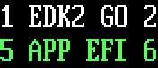

# Aplicación EFI desde el volumen del Go

`DXE_APP` conserva la consola corregida y añade `ConsoleProbe.efi` como archivo de tipo APPLICATION en el FV interior. El GUID de archivo es `a63728d5-057a-43bb-88f7-89aa3e5856e9`. La aplicación es un PE32+ AArch64 con subsistema EFI Application. El perfil empaqueta por separado el núcleo DXE, DevicePathDxe, InheritedGopDxe y ConsoleProbe. [Aplicación](../OculusGoPkg/Applications/ConsoleProbe/ConsoleProbe.c) · [Volumen](../OculusGoPkg/OculusGoPkg.fdf)

El despachador inicia los dos drivers. Una vez disponible la consola, el lanzador obtiene la ruta del volumen que suministró el driver de pantalla y añade un nodo de archivo FV con el GUID de la aplicación. Llama a `BootServices->LoadImage(FALSE, parent, path, NULL, 0, &handle)`. DXE lee la sección PE32 desde el volumen, carga la aplicación y publica su protocolo Loaded Image. El lanzador comprueba el volumen, el padre, la ruta y los tipos de memoria antes de invocar `BootServices->StartImage()`. [Lanzador](../OculusGoPkg/DxeCheckpoint/AppLaunch.c) · [Fuentes de DXE y especificación](REFERENCES.md#dxe_app)

La aplicación recibe su handle y la tabla del sistema. Coloca el cursor en la fila 12, selecciona verde claro y llama a `SystemTable->ConOut->OutputString()` para reemplazar la segunda línea por `5 APP EFI 6`. Comprueba el cursor y devuelve el estado a EDK2. La primera línea, `1 EDK2 GO 2`, la dibuja DXE antes de cargar la aplicación. Así se puede identificar visualmente qué ejecutable produjo cada línea. La señal óptica acredita el dibujo. La traza del invitado comprueba además el retorno y la descarga.

En este perfil temprano la plataforma habilita la ejecución en las páginas de texto del PE dentro de la arena DXE ya medida. Verifica los descriptores, aplica la transición RW/XN → RX e invalida las traducciones. Al descargar esa aplicación se restablecen los permisos RW/XN antes de devolver las páginas al asignador. La instrumentación reutiliza la validación de secciones de los drivers. [Permisos y descarga](../OculusGoPkg/DxeCheckpoint/Dispatch.c)

## Reproducir la prueba

Ejecuta estos comandos desde el checkout del candidato, con el EDK2 fijado y los originales locales del Go.

```sh
bash scripts/build.sh DEBUG 12 DXE_APP
python3 tools/android_boot.py --fd "$run/OCULUS_GO_DIRECT.fd" --stock-boot "$boot_original" --dtb "$dtb_evt" --output "$imagen"
DXE_QEMU_JOBS=8 bash scripts/check-sec-dxe.sh "$run" "$imagen"
```

`run` es el directorio de salida que imprime la compilación. El verificador vuelve a extraer el FD del contenedor Android y compara la sección PE de la aplicación con el archivo compilado. El observador verifica la llamada por ruta FV, el handle y la tabla del sistema en la entrada PE, el llamador de `OutputString()`, los píxeles de ambas vistas y el estado devuelto por `StartImage()`. [Auditoría estática](../tests/sec_dxe_static.py) · [Observador ARM64](../tests/dxe_app_trace.py)

## Imagen y traza del arranque ordinario

| Artefacto | Tamaño | SHA-256 |
| --- | ---: | --- |
| ConsoleProbe.efi leído desde el FV | 24 576 bytes | `4b4646b581aa62dca810caaf5285b07a7b9818b41f5aee613139c111041bf6da` |
| FD reextraído | 4 194 304 bytes | `0b199c89b4c7846fef3eeeca13b26fabea930e8847bdcc60d33f19f5deffc436` |
| Contenedor Android local | 487 424 bytes | `077e897847fae765cefbcba39d15caefc2959a2ea8abeb8eebe203629651dd9e` |

En los arranques ordinarios EL1 y EL2, la aplicación se cargó en `0x80221000` y su entrada PE estaba en `0x80222000`. Al entrar en `OutputString()` el registro de enlace apuntaba a `0x802221fc`, dentro de las páginas ejecutables de ConsoleProbe. La tabla del sistema y el handle del punto de entrada coincidieron con los del cargador. Estas direcciones son mediciones del modelo. El perfil usa la dirección de carga que le asigna DXE.



QEMU completó 90 casos, 45 en EL1 y 45 en EL2. Los seis arranques previstos llegaron al final y los otros 84 alcanzaron el punto de rechazo correspondiente. En los 90 casos se comprobaron la superficie completa del framebuffer y sus guardas. Una segunda ejecución de los diez casos relacionados con la aplicación reprodujo las mediciones y ambas capturas. En esa ejecución también se comprobó que `CoreFreePages()` devolvía el control al descargar la aplicación.

La falta del archivo en el FV dio `EFI_NOT_FOUND` en `LoadImage()`. Al hacer fallar la primera carga de un glifo, `OutputString()`, la salida de la aplicación y `StartImage()` devolvieron `EFI_INVALID_PARAMETER`. La segunda fila conservó el dibujo previo. Ambos controles se introducen sólo en QEMU. El ELF intermedio recibió el aviso habitual de GNU ld sobre segmentos LOAD RWX. Los permisos de las páginas activas del PE se verificaron durante la ejecución del invitado. [Resultados por caso](evidence/dxe-app-qemu-20261120.json)

## Prueba física pendiente

La imagen local y sus entradas se verifican con `python tools/run_dxe_app_once.py` sin argumentos. Para el arranque temporal en el visor, el operador deberá observar las dos filas con cada ojo en posición normal. La fila superior blanca identifica la consola inicializada y la inferior verde identifica la salida de ConsoleProbe. El registro de la consola anterior se conserva con su propia revisión. [Manifiesto](evidence/dxe-app-review-20261120.json) · [Recuperación](RECOVERY.md)
