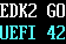

# Consola de texto sobre el GOP del Oculus Go

`DXE_TEXT` continúa desde el [GOP observado en el visor](evidence/dxe-gop-transfer-20261120.json). DevicePathDxe publica Device Path Utilities. InheritedGopDxe publica GOP, la ruta de dispositivo y Simple Text Output en el mismo handle. DXE localiza ese handle, comprueba la identidad del GOP y la dirección de `OutputString`, instala `ConsoleOutHandle` y `ConOut` en la tabla del sistema y recalcula su CRC32.

El punto de entrada que prueba la imagen es `SystemTable->ConOut->OutputString()`. Primero escribe **EDK2 GO** en blanco y ejecuta retorno de carro y salto de línea. Comprueba la posición resultante, centra la segunda línea y escribe **UEFI 42** en cian claro. El bucle final se alcanza después de ambos retornos con `EFI_SUCCESS`. Si falla la selección de consola o una operación de salida, las bandas muestran blanco, morado, rojo, morado y blanco. [Código que consume la consola](../OculusGoPkg/DxeCheckpoint/TextOutput.c)

## Qué representa la pantalla

El modo 0 ofrece 80 columnas y 25 filas. Cada celda lógica ocupa 16×38 píxeles y duplica cada píxel del glifo 8×19 de EDK2. El backend rota las celdas hacia el scanout nativo y las sube dos veces con `EfiBltBufferToVideo`. Cada carga se limita a 38×16 píxeles físicos. La fuente cubre ASCII imprimible y los 50 caracteres gráficos de UEFI. La consola admite retorno de carro, salto de línea, retroceso, salto a la línea siguiente por ancho y desplazamiento vertical. El cursor lógico es invisible. El perfil físico escribe solamente las celdas de las dos líneas sobre la señal del GOP. [Implementación](../OculusGoPkg/Drivers/InheritedGopDxe/TextConsole.c) · [Origen de la fuente](../THIRD_PARTY_NOTICES.md#console-font)

El perfil representa cada ojo con una mitad lógica de 1280×1440. El recorte de QEMU aplica el mismo giro previsto por el perfil. La observación física de abajo sitúa las letras al revés en la posición habitual del visor. La superficie heredada y su stride proceden de las capturas originales. La consola de este perfil trabaja con la fuente de EDK2 y el GOP ya localizado. La consola genérica GraphicsConsoleDxe de upstream necesita los servicios HII de base de datos y fuentes. Este paso mantiene la arena de DXE y los dos drivers de la prueba física anterior. [Referencias](REFERENCES.md#dxe_text)

## Reproducir en Debian o WSL

```sh
bash scripts/build.sh DEBUG 12 DXE_TEXT
python3 tools/android_boot.py --fd "$run/OCULUS_GO_DIRECT.fd" --stock-boot "$boot_original" --dtb "$dtb_evt" --output "$imagen"
DXE_QEMU_JOBS=8 bash scripts/check-sec-dxe.sh "$run" "$imagen"
```

`run` es el directorio que imprime el compilador. Los archivos originales y la imagen Android se mantienen locales. La prueba extrae el FD del mismo contenedor que se usaría en el visor. En QEMU, el observador comprueba el CRC de la tabla del sistema, el puntero del protocolo, los argumentos UTF-16, las dos devoluciones de la llamada y las 28 cargas de glifos a través del GOP. Después compara cada byte de la superficie completa y sus guardas contra la fuente fijada y el patrón previo. Los PNG son recortes de RAM de los invitados ordinarios, rotados a coordenadas de lectura. [Observador](../tests/dxe_text_trace.py)

## Imagen revisada

| Artefacto | Tamaño | SHA-256 |
| --- | ---: | --- |
| Contenedor Android local | 487 424 bytes | `715bc641bc143fd01dc01da58dfd95962fb956dcc0a2dd8e5b1babb1b6f76b7e` |
| FD reextraído | 4 194 304 bytes | `97c55d08c4c6b32b4801432eb7060806cfcbf70c9c7200ac1cae5fd65d9429a4` |

El volumen contiene el núcleo y dos drivers. La expresión DEPEX del driver de pantalla contiene un único GUID, el de Device Path Utilities. En una compilación preliminar la auditoría detectó que el enlace pedía además `gEfiPcdProtocolGuid`. El perfil definitivo selecciona la biblioteca PCD fija para este módulo. La auditoría de procedencia encontró 20 entradas propias del proyecto, una fuente adaptada de EDK2, 359 entradas de upstream y 93 generadas. GNU ld avisó de segmentos LOAD RWX en los ELF intermedios. El verificador comprueba por separado los permisos de los PE y las páginas activas en el invitado.

## Captura del framebuffer en QEMU



En QEMU AArch64 pasaron los 86 casos del contenedor revisado, 43 en EL1 y 43 en EL2. Seis arranques llegaron al texto final: el ordinario, el que entra con caché de instrucciones activa y el que reordena la tabla de configuración, en ambos niveles de excepción. Los otros 80 alcanzaron su punto de rechazo previsto. Al omitir el protocolo de texto o hacer fallar la primera carga de glifo, DXE mostró el patrón de error. En los 86 casos coincidieron la superficie completa y sus guardas con la predicción.

El recorte muestra 112 × 76 píxeles de un ojo en coordenadas de lectura. El segundo ojo contiene los mismos píxeles. El SHA-256 del RGB sin comprimir es `857bfdb8401e795369bce60028a9b123bcececae3fd3b61cdee7eeac5ab7a5dd`. Las dos llamadas a `OutputString()` devolvieron `EFI_SUCCESS`. Las dos líneas ocuparon 14 celdas por ojo, incluidos los dos espacios. [Resultados por caso](evidence/dxe-text-qemu-20261120.json)

## Observación física del 20 de noviembre

La imagen histórica y su verificador corresponden a la revisión `0dde2c3`. En ese checkout la revisión local se repite con `python tools/run_dxe_text_once.py` desde la raíz. El nuevo candidato tiene su propio manifiesto. [Corrección de orientación](DXE_TEXT_UPRIGHT.md) Ese modo compara el contenedor, el FD, los informes, los dos PNG y las fuentes con el manifiesto. [Manifiesto de la prueba temporal](evidence/dxe-text-review-20261120.json)

El gestor original de Pacific aceptó la imagen en RAM con Secure Boot activo. El operador vio el patrón azul, rojo, amarillo, rojo y azul y reconoció texto invertido al ponerse el visor en su posición habitual. Al girarlo pudo leer ambas líneas completas: «EDK2 GO» en blanco y «UEFI 42» en azul según su percepción. El programa solicitó `EFI_LIGHTCYAN` para la segunda línea. Esta lectura demuestra que la consola UEFI dibujó caracteres reconocibles en el Go. [Registro de la prueba física](evidence/dxe-text-transfer-20261120.json)

La lectura tras girar el visor respalda corregir la orientación con media vuelta dentro de cada vista lógica. La transformación debe mantener la posición del cursor, el salto de línea y el desplazamiento de pantalla en el mismo sistema de coordenadas. La entrada de teclado y el arranque de la Shell quedan pendientes. [Procedimiento de recuperación](RECOVERY.md)

Android volvió a completar el arranque en el mismo Go y en el slot A. La lectura completa posterior de `boot_a`, `boot_b`, `aboot_a` y `aboot_b` abarcó 136 314 880 bytes. Los cuatro SHA-256 coincidieron con la lectura previa y los respaldos originales. El operador confirmó las cadenas y sus colores. La cobertura por ojo quedó sin informar. [Hashes y recuperación](evidence/dxe-text-transfer-20261120.json)
