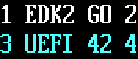

# Orientación de la consola del Go

En el primer arranque físico de la consola, el operador pudo leer «EDK2 GO» y «UEFI 42» al girar el visor. La nueva imagen gira 180° tanto los glifos como sus posiciones dentro de cada mitad. Mantiene el modo 80×25, el orden BGR y el framebuffer heredado. La numeración identifica las cuatro esquinas del mensaje central. [Observación física anterior](evidence/dxe-text-transfer-20261120.json) · [Implementación](../OculusGoPkg/Drivers/InheritedGopDxe/TextConsole.c)

| Con el visor puesto normalmente | Izquierda | Texto | Derecha |
| --- | --- | --- | --- |
| Fila superior, blanco | 1 | EDK2 GO | 2 |
| Fila inferior, cian claro | 3 | UEFI 42 | 4 |

## Qué se ha comprobado

En el scanout de 1440×2560, dentro de cada mitad de 1440×1280, la transformación respecto al diagnóstico anterior es `(x, y) → (1439 − x, 1279 − y)`. Al pasar a la mitad siguiente se suma su origen vertical. En el nuevo mapa la columna de texto avanza hacia Y creciente y la fila hacia X decreciente. Se aplica lo mismo al borrado de filas y al desplazamiento al final de la pantalla. Un solo carácter ocupa 38×16 píxeles nativos por vista.

La prueba ARM64 de desplazamiento llama a la consola y al GOP del proyecto sobre RAM de QEMU en modo usuario. Escribe glifos asimétricos en los extremos, escribe una «F» en la última celda y comprueba el salto y el cursor lógico en (0, 24). Compara los 11 059 200 bytes de la superficie con una predicción independiente, incluidos los márgenes, los datos desplazados y el fondo azul de la última fila. Las funciones de memoria y la instalación del protocolo las proporciona el programa de prueba. Como controles, la versión física anterior falló al comparar el primer glifo y una variante con el desplazamiento invertido falló al comparar el framebuffer tras el salto de línea. [Prueba ARM64](../tests/text_scroll_qemu.c)

La prueba de sistema completo usa el FD reextraído de la imagen Android, el despachador DXE y las dos llamadas reales a `ConOut->OutputString()`. Comprueba por separado la imagen en coordenadas de lectura y el orden nativo de los bytes BGR. El texto central se coteja además con la huella del recorte de siete columnas observado en el QEMU de la imagen anterior. Los cuatro marcadores se añaden fuera de ese recorte. [Observador](../tests/dxe_text_trace.py) · [Prueba de la rotación respecto a la captura anterior](../tests/test_dxe_text.py)

## Resultado en QEMU



QEMU AArch64 10.0.13 completó 86 casos, 43 en EL1 y 43 en EL2. Los seis arranques previstos alcanzaron el punto final tras dos llamadas a `OutputString()` y 44 cargas de glifos por arranque entre las dos vistas. Los 80 casos de fallo terminaron en su punto de rechazo previsto. En todos coincidieron la superficie completa y sus guardas. Al repetir por separado el arranque ordinario en ambos niveles se reprodujeron las mediciones y los PNG byte por byte. [Informe por caso](evidence/dxe-text-upright-qemu-20261120.json)

El recorte de cada ojo en coordenadas de lectura mide 176×76 y tiene SHA-256 RGB `6b62c0ea0c40948228216ccc00ac275b8ee97f9fe36dc3aba589cc4cbb513da6`. En orden de scanout nativo, el mismo recorte ocupa 76×176 píxeles BGR y tiene SHA-256 `4f94cc2d104d32e5d99ac6544e70fdaf723c5e35ad7dae4aaadd2c79b2ce5bb8`. Los dos ojos coinciden en ambas mediciones. El sentido óptico real queda pendiente de comprobar con el visor puesto.

## Reproducción

Desde el checkout de esta revisión, con los datos originales locales:

```sh
bash scripts/build.sh DEBUG 12 DXE_TEXT
python3 tools/android_boot.py --fd "$run/OCULUS_GO_DIRECT.fd" --stock-boot "$boot_original" --dtb "$dtb_evt" --output "$imagen"
DXE_QEMU_JOBS=8 bash scripts/check-sec-dxe.sh "$run" "$imagen"
bash scripts/test-text-scroll-qemu.sh
```

`run` es el directorio de salida que imprime el compilador. La prueba de desplazamiento necesita el compilador AArch64 de Linux con libc estática y `qemu-aarch64`. El verificador local de este candidato se ejecuta con `python tools/run_dxe_text_upright_once.py`. [Manifiesto del candidato](evidence/dxe-text-upright-review-20261120.json)

## Imagen local

| Artefacto | Bytes | SHA-256 |
| --- | ---: | --- |
| Imagen Android candidata | 487 424 | `aace39fe4e1dcbd6cd2b4273499706df20e77bc97c9acf6620adb87c759b909c` |
| FD reextraído | 4 194 304 | `bbfe56cb227d92dc13b7061871420c913b0cd0407712895f3a2be492510ab0bd` |

Al comparar la auditoría del compilador con la del primer DXE_TEXT, sólo difieren dos fuentes de plataforma: `TextConsole.c` y `TextOutput.c`. La primera aplica la transformación. La segunda añade los números y posiciona el texto. GNU ld volvió a avisar de segmentos LOAD RWX en los ELF intermedios de GOP y DXE Core. La prueba de sistema completo verificó los permisos de las páginas activas del invitado. [Política de fuentes](SOURCE_POLICY.md)

## Lectura física pendiente

Con el visor en posición habitual, observar cada ojo por separado y transcribir las dos líneas, la posición de los números y cualquier recorte. Esta observación determinará si la corrección funciona bajo las lentes. El intento del primer DXE_TEXT está registrado por separado. [Procedimiento de recuperación](RECOVERY.md)
