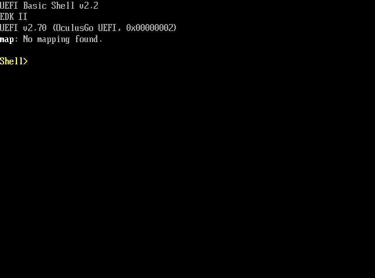
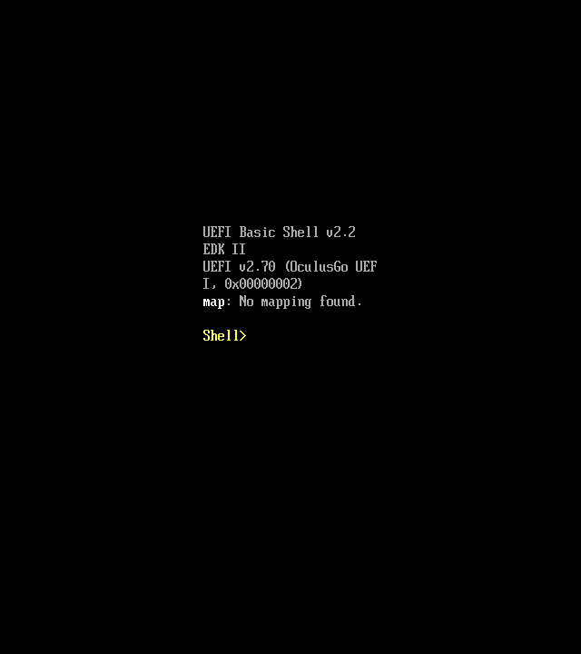

# La Shell en el arranque normal del Go

El núcleo DXE de EDK2 despacha los drivers y entrega el control al protocolo BDS de la plataforma. GoBds busca el GOP del visor por su ruta de dispositivo, abre la consola de texto en ese mismo handle y la publica en `ConOut` y `StdErr`. Actualiza el CRC de la tabla del sistema. El driver ConSplitter de EDK2 publica `ConIn` y su evento de espera. Queda pendiente conectar una fuente de teclas del visor. [Política de arranque](../OculusGoPkg/Drivers/GoBdsDxe/GoBds.c)

BDS forma una ruta de archivo con el handle del volumen del que se cargó y el GUID oficial de la aplicación Shell. Llama a `LoadImage()` con la ruta y un búfer nulo y después a `StartImage()`. BDS publica el fabricante en memoria de ejecución y la revisión de la plataforma en la tabla del sistema antes de emitir EndOfDxe. El volumen contiene la aplicación AArch64 compilada desde `ShellPkg/Application/Shell/Shell.inf`. HII suministra los textos. La Shell de nivel básico tiene habilitado el prompt y usa el almacén de variables emulado en RAM durante esta sesión. El reloj virtual usa el contador arquitectónico y toma como fecha inicial la de compilación de su biblioteca. Una recompilación limpia puede generar otro SHA-256. El registro identifica los binarios exactos usados en la prueba. [Shell y servicios de plataforma](REFERENCES.md#shell-en-el-arranque-normal)

El arranque actual puede presentar una pirámide de vidrio en 3D antes de cargar la Shell. [Bienvenida y captura](WELCOME.md)

## Memoria y hardware del modelo

El encabezado ARM64 declara 20 MiB a partir de `0x80080000`. La cabecera y el volumen comprimido ocupan los primeros 4 MiB. Los 16 MiB restantes, `[0x80480000, 0x81480000)`, forman parte de los bytes entregados por el cargador. SEC verifica la posición del código y lee dos firmas y el relleno completo antes de escribir la pila. El asignador recibe sólo la zona dentro de la imagen. El framebuffer queda reservado por separado. [Entrada SEC](../OculusGoPkg/PrePi/Entry.S) · [Mapa](../OculusGoPkg/PrePi/Memory.c)

`NORMAL` usa las direcciones GIC de Pacific y su frecuencia de temporizador. `SHELL_QEMU` conserva el flujo SEC → DXE → BDS → Shell y el framebuffer del Go. Para la placa virtual selecciona las direcciones del GIC de QEMU, la frecuencia del contador virtual y un UART PL011 para registrar la carga. Las observaciones en el modelo y en el visor se registran por separado. [Mapa de Pacific](MEMORY_MAP.md) · [Modelo de QEMU](https://www.qemu.org/docs/master/system/arm/virt.html)

Para ejecutar también el FD de Pacific en QEMU, una prueba del host configura traducción de etapa 2 en EL2. El GIC que el invitado direcciona en `0x09bc0000` y `0x09c00000` lo atiende el GICv3 de la placa virtual. QEMU usa un único Cortex-A57 y un contador de 19,2 MHz. El invitado entra en EL1 con el DTB EVT en `x0`. La prueba observa los píxeles directamente en RAM. El código de EL2 reside en un ELF de prueba separado del FD y del contenedor Android. [Modelo del GIC](../tests/pacific_qemu_el2.S)

## Reproducir

Desde la raíz del repositorio en WSL Debian, sustituye `run` por el directorio que imprime la compilación.

```sh
bash scripts/build.sh DEBUG 12 SHELL_QEMU
python3 tests/shell_prompt_qemu.py "$run/OCULUS_GO_DIRECT.fd" \
  Build/OculusGoShellQemu/DEBUG_GCC5/AARCH64/Shell.efi "$run/eye-el1" --el 1
```

Usa `--el 2` en otro directorio de salida para repetir en EL2. Para la prueba de la imagen Pacific, compila `NORMAL` y usa el DTB EVT preservado. La primera orden verifica el volumen y la segunda lo ejecuta en el modelo con las direcciones del Go.

```sh
bash scripts/build.sh DEBUG 12 NORMAL
python3 tests/shell_prompt_qemu.py "$normal/OCULUS_GO_DIRECT.fd" \
  Build/OculusGo/DEBUG_GCC5/AARCH64/Shell.efi "$normal/physical" --inspect-only
python3 tests/shell_prompt_qemu.py "$normal/OCULUS_GO_DIRECT.fd" \
  Build/OculusGo/DEBUG_GCC5/AARCH64/Shell.efi "$normal/pacific-el1" --pacific-dtb "$dtb_evt"
python3 tests/shell_arena_qemu.py "$normal/OCULUS_GO_DIRECT.fd" \
  Build/OculusGo/DEBUG_GCC5/AARCH64/OculusGoPkg/PrePi/PrePi/DEBUG/OculusGoSec.dll "$normal/arena.json"
```

El observador extrae el PE de la aplicación del volumen comprimido y lo compara con el compilado. Deja correr la CPU desde el encabezado. QMP lee el framebuffer del invitado, compara las dos mitades completas y decodifica las letras en su orientación de lectura. Dos capturas sucesivas deben coincidir después de que aparezcan el banner y el prompt.

La primera captura histórica muestra el área de texto de un ojo reducida a la mitad. Para reproducir ese primer FD con el observador actual, pasa `--layout legacy`. La Shell sitúa el prompt en la primera columna. La prueba física anterior confirmó los caracteres cerca del centro de cada lente. La lectura de esta primera columna queda para la prueba del visor.

## Resultado del 20 de noviembre

Los arranques con UART en EL1 y EL2 registraron la carga de `GoBdsDxe.efi` seguida por `Shell.efi`. El área de texto coincidió píxel por píxel en ambas pruebas y en la del firmware Pacific. El FD de Pacific reextraído del contenedor Android mostró la Shell de EDK2 v2.2 y el prompt amarillo `Shell>` en ambas vistas. Entre el banner y el prompt, `map` informó que no encontró volúmenes de archivos. El ejecutable de 368 640 bytes estaba en el archivo de tipo APPLICATION del FV interior. La aplicación se ejecutó con la tabla del sistema del Go y la revisión `0x00000002`. GNU ld avisó de segmentos LOAD con permisos RWX en ejecutables ELF intermedios. La prueba comprueba la carga del PE y la salida visible. La protección de páginas de todos los drivers del arranque normal, el teclado físico y la lectura por las lentes quedan pendientes.



La entrada de SEC se comprobó en el FD exacto de Pacific en EL1 y EL2. En los dos arranques limpios el puntero de pila llegó a `0x8147ffa0` y conservó la dirección del DTB. En los otros diez casos, SEC rechazó una de cuatro corrupciones de la zona de RAM o un DTB que la invadía. El valor original de SP y los bytes de la futura pila coincidieron antes y después de los rechazos. [Casos de SEC](evidence/shell-pacific-arena-20261120.json)

| Resultado | Evidencia |
| --- | --- |
| Shell y prompt del FD Pacific en QEMU | [Captura decodificada](evidence/shell-pacific-el1-20261120.json) |
| Módulos del FV Pacific y hash del PE | [Inspección estática](evidence/shell-pacific-static-20261120.json) |
| Carga por DXE y BDS con UART de QEMU | [EL1](evidence/shell-qemu-el1-20261120.json) · [EL2](evidence/shell-qemu-el2-20261120.json) |
| Candidato para arranque temporal | [Manifiesto y hashes](evidence/shell-review-20261120.json) |

El contenedor Android ocupa 684 032 bytes y su SHA-256 es `3016d03871843546abef8c0ce35b14a4ca136556cc6879f0eb78e6b03362b6d7`. Se conserva localmente con el DTB EVT. Para verificarlo en el equipo de compilación se ejecuta `python tools/run_shell_once.py` sin argumentos. Fastboot aceptó esta imagen en el Go con Secure Boot activo. El operador leyó `hell>` en el ojo izquierdo y distinguió parte de la consola en el derecho. La primera letra quedó fuera de su visión. El visor volvió a Android en la ranura A. Las cuatro particiones de arranque coincidieron con los respaldos y con su lectura anterior. [Registro físico](evidence/shell-transfer-20261120.json). [Recuperación comprobada](RECOVERY.md)

## Corrección para leer la primera columna

El primer modo colocaba el rectángulo de `Shell>` en `(0, 435)` en cada vista de 1280 × 1440. El visor confirmó que el borde izquierdo corta la primera letra. El nuevo modo 2 ofrece 24 columnas y 12 filas de 16 × 38 píxeles. BDS lo selecciona antes de entregar la consola a la Shell. Las líneas largas se ajustan al ancho anunciado por `QueryMode` y el desplazamiento vertical opera dentro de la ventana. El modo estándar 0 de 80 × 25 sigue disponible para las aplicaciones que lo seleccionen. [Implementación](../OculusGoPkg/Drivers/InheritedGopDxe/TextConsole.c) · [Investigación óptica](REFERENCES.md#campo-de-visión-y-lectura-de-la-shell-en-el-go)

En coordenadas por ojo con el visor puesto, la ventana comienza en `(448, 492)` y ocupa 384 × 456 píxeles. El prompt comienza en `(448, 720)` y sus seis celdas ocupan 96 × 38 píxeles. La prueba en QEMU decodifica los glifos del framebuffer, compara las vistas completas y verifica el margen negro. La captura de abajo abarca un ojo completo a mitad de resolución. En el arranque temporal de esta imagen en el Go, el operador comprobó por separado que podía leer `Shell>` completo y todas las líneas superiores con cada ojo. [Observación física de la Shell centrada](evidence/shell-centered-transfer-20261120.json)



La imagen usada en este arranque temporal tiene SHA-256 `8e4d3b7851fd6d3afb301e7da8dbf33e9f359240ba12c116cb78b3653356fbd6`. La comprobación offline es `python tools/run_centered_shell_once.py`. La sesión anterior conserva su propio registro de intento consumido. [Evidencia del FD de Pacific](evidence/shell-centered-pacific-el1-20261120.json) · [Revisión de la imagen centrada](evidence/shell-centered-review-20261120.json)
